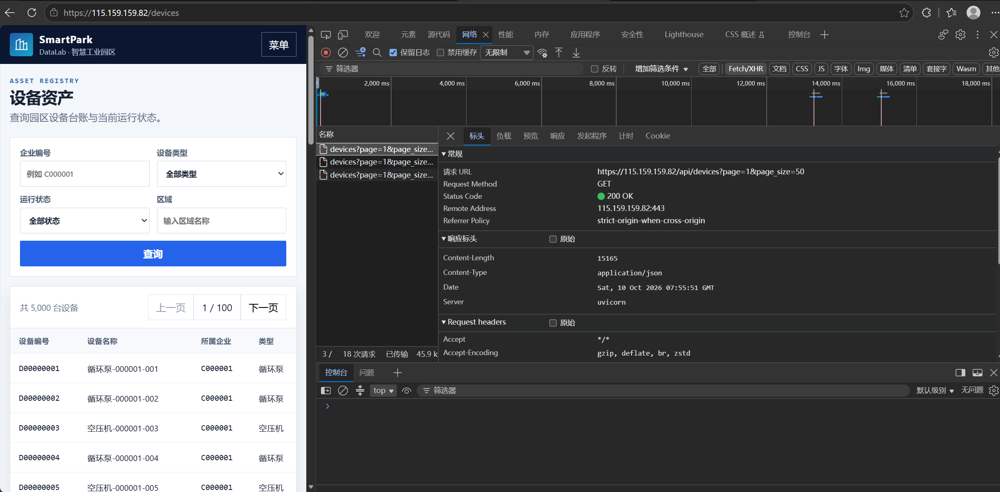
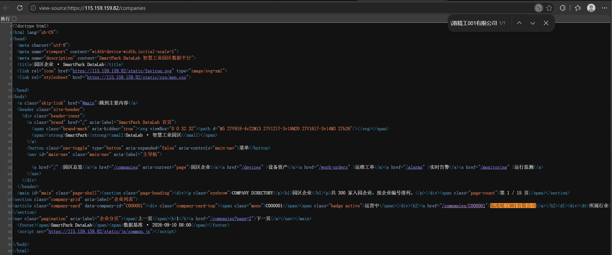
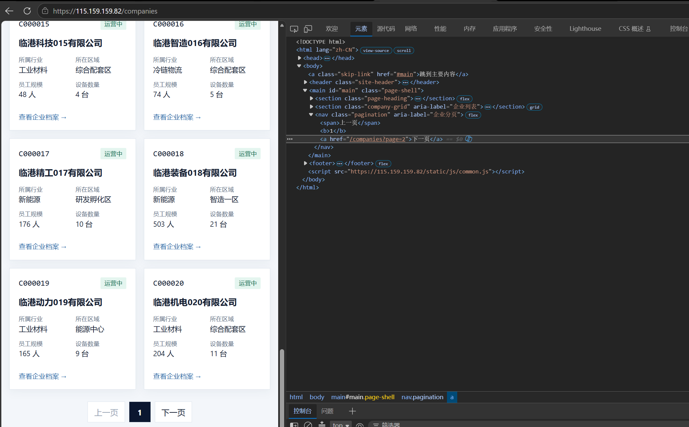
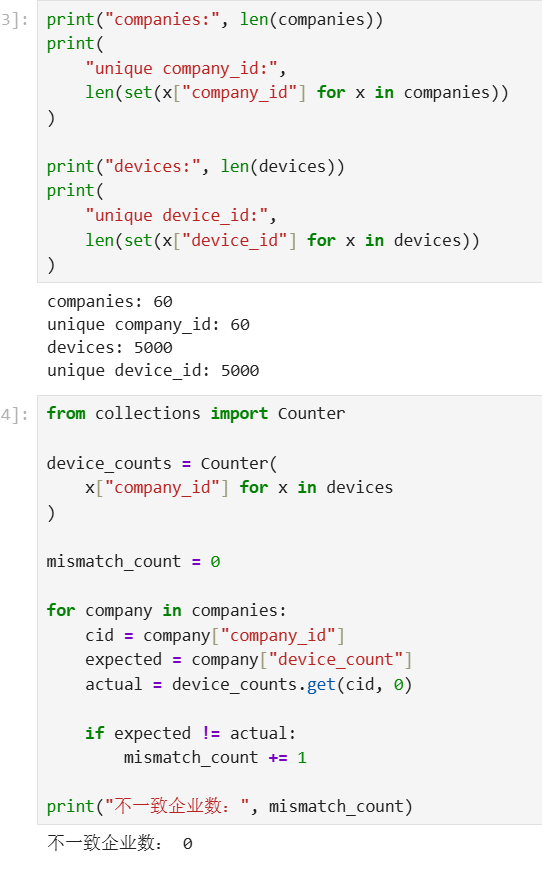

# Lab 1 实验报告

## 学生信息

- **姓名：** 王嘉涛
- **学号：** 112404260124
- **班级：** 数据1241
- **GitHub 用户名：** Komakaze
- **仓库地址：** https://github.com/Komakaze/bigdata-collection-labs-112404260124

> 文件位置：`lab01/REPORT.md`；完整代码保存在 `lab1_html_api.ipynb`。

---

# 任务 1：判断数据加载方式

## 1.1 Device：判断动态加载并找到 API

### 判断结果

- 页面：`/devices`
- 数据加载方式：**动态加载**
- 判断依据：

1. 用"查看网页源代码"后按 Ctrl + F 搜索页面上的设备名称（如 `循环泵-000001-001`），源代码中**搜不到**；
2. 在 Network 的 Fetch/XHR 中刷新页面后，找到返回设备 JSON 的请求 `GET /api/devices?page=1&page_size=50`，响应体里正是页面显示的设备列表。

### API 信息

- Request URL：`https://115.159.159.82/api/devices?page=1&page_size=50`
- Request Method：`GET`
- Query 参数：`page`（页码）、`page_size`（每页条数）；另支持可选过滤 `company_id`、`device_type`、`status`、`zone`

### 【截图 1】Device API 发现证据



---

## 1.2 Company：判断静态加载

- 页面：`/companies`
- 数据加载方式：**静态加载**
- 判断依据：

使用"右键 → 查看网页源代码"后，按 Ctrl + F 搜索页面上真实显示的企业名称（如 `临港精工001有限公司`），**能在源代码中找到**，且能看到对应的 `<article class="company-card" data-company-id="C000001">` 记录，说明企业数据随初始 HTML 一起返回。

### 【截图 2】Company 静态加载证据



---

# 任务 2：Device API 分页采集

## 2.1 API 分页结构

| 含义 | JSON 字段 |
|---|---|
| 当前页 | `page` |
| 每页条数 | `page_size` |
| 设备总数 | `total` |
| 设备列表 | `items` |

---

## 2.2 关键代码

```python
# 从第一页响应中读取分页信息
total = data["total"]
page_size = data["page_size"]

total_pages = (total + page_size - 1) // page_size

devices = []

for page in range(1, total_pages + 1):
    r = requests.get(
        api_url,
        params={
            "page": page,
            "page_size": page_size
        },
        timeout=10
    )

    page_data = r.json()
    page_items = page_data["items"]
    devices.extend(page_items)
```

---

## 2.3 采集结果

- 每页条数：100
- 设备总数：5000
- 程序计算得到的总页数：50
- 最终采集设备数：5000
- 唯一 `device_id` 数：5000

> 说明：截图 1 中浏览器请求 URL 里的 `page_size=50` 是网页前端自己的默认值；用 `requests` 采集时 `page_size` 是调用方可自选的查询参数（服务端上限 100），本实验取 100 以减少请求次数，两种取值采到的 5000 条数据完全相同。

回答：

> 为什么总页数应由 API 返回的 `total` 和 `page_size` 计算，而不是直接在代码里写死？

答：因为数据总量会随平台数据更新而变化，写死页数在总数增加时会漏采、在总数减少时会多请求空页而产生脏数据或报错。用 total 与 page_size 计算 ceil(total / page_size)，可以让程序自动适配任意数据规模，代码更健壮、可复用。

---

# 任务 3：Company HTML 解析

## 3.1 企业记录 Selector

- 企业记录 selector：`article.company-card`
- 第 1 页企业记录数：20

说明为什么选择这个 selector：

- 主要使用了 `id / class / data-* / 父子层级` 中的哪一种？
- 是否参考过浏览器 Copy selector 或 AI？
- 最终为什么采用现在这个写法？

答：主要使用 class（company-card），并利用同一节点上的 data-* 属性（data-company-id）取字段。参考过浏览器 Copy selector，但它生成的是带 nth-child(...) 的长路径，对页面结构变化敏感，因此弃用。article.company-card 短、语义明确（article 标签 + 语义化 class），整页所有企业卡片共享同一 class，既能一次选中全部记录，又不会误选页面上其他元素；解析字段时再在每条记录内部用相对 selector 定位，稳定性最好。

---

## 3.2 关键代码

```python
cards = soup.select("article.company-card")

card = cards[0]

company_id = card.get("data-company-id")
name = card.select_one("h2 a").get_text(strip=True)
status = card.select_one(".company-card-top .badge").get_text(strip=True)
```

行业、区域、设备数量使用 `dt/dd` 结构后，请写出你最终如何得到：

```python
details = {}
for item in card.select("dl > div"):
    key = item.select_one("dt").get_text(strip=True)
    value = item.select_one("dd").get_text(strip=True)
    details[key] = value

industry = details["所属行业"]
zone = details["所在区域"]
device_count = int(details["设备数量"].replace("台", "").strip())
```

---

## 3.3 字段来源说明

任选 **2 个字段**说明：

1. 字段：`company_id`
   - 来自：`HTML 属性`
   - 使用的方法：card.get("data-company-id")，直接读取卡片节点上的 data-* 属性，比从文本里截取编号更可靠。

2. 字段：`device_count`
   - 来自：`文本`
   - 使用的方法：先用 dt/dd 键值对建字典取到 "6 台"，再用 .replace("台", "").strip() 去单位、int() 转成整数，便于后续与 Device 统计结果比较。

---

# 任务 4：Company “下一页”分页

## 4.1 下一页元素

- “下一页” selector：`nav.pagination a:last-child`
- 第 1 页 `href` 示例：`/companies?page=2`

### 【截图 3】Company “下一页”元素



---

## 4.2 关键代码

```python
next_link = soup.select_one("nav.pagination a:last-child")

next_href = next_link.get("href")

next_url = urljoin(
    current_url,
    next_href
)
```

再用 2～3 句话说明：

> 你的程序如何完成“当前页 → 找下一页 href → 请求下一页 → 再解析”的循环？

答：程序以 current_url 记录当前页地址，每轮先请求并解析本页企业记录并入总列表，再用 nav.pagination a:last-child 找到"下一页"的 href，通过 urljoin 把相对路径拼成绝对地址赋回 current_url 作为下一轮输入；同时用计数器限制只采 3 页，当找不到下一页链接（返回 None）时循环结束。

---

## 4.3 三页采集结果

| 页码 | 企业数 |
|---|---:|
| 1 | 20 |
| 2 | 20 |
| 3 | 20 |
| **合计** | **60** |

- 唯一 `company_id` 数：60

---

# 任务 5：结果验证

## 5.1 最终结果

| 检查项 | 结果 |
|---|---:|
| Company 总数 | 60 |
| 唯一 `company_id` | 60 |
| Device 总数 | 5000 |
| 唯一 `device_id` | 5000 |
| Company–Device 不一致企业数 | 0 |

### 【截图 4】最终验证结果



---

## 5.2 一致性检查关键代码

```python
from collections import Counter

device_counts = Counter(
    x["company_id"] for x in devices
)

mismatch_count = 0

for company in companies:
    cid = company["company_id"]
    expected = company["device_count"]
    actual = device_counts.get(cid, 0)

    if expected != actual:
        mismatch_count += 1
```

回答：

> 为什么 `status_code == 200` 仍然不能说明“数据已经采集正确”？

答：200 只表示这次 HTTP 请求被服务端成功处理，并不保证返回内容就是我们想要的数据。可能出现的偏差包括：分页参数写错导致只拿到部分数据、字段定位错导致取到 None 或错误文本、翻页逻辑错误导致重复采集同一页、数字带单位未转换等。因此必须再做数量核对、ID 唯一性检查和跨数据源一致性比对，才能确认采集结果正确。

---

# 任务 6：保存采集结果

确认已经生成：

```text
data/companies.json
data/devices.json
```

填写：

- `companies.json`：已生成（60 条）
- `devices.json`：已生成（5000 条）

---

# 实验结论

答：静态加载页面的数据随初始 HTML 一起返回，只需请求一次 URL，用 BeautifulSoup 解析即可；动态加载页面的数据由 JavaScript 通过 API 异步获取，必须先在 Network 中找到接口，再直接请求 JSON。HTML"下一页"分页靠解析页面里的链接并逐页请求，属于"用页面导航驱动采集"；API page 分页则直接改查询参数，并可用 total、page_size 算出页数。我通过数量核对、id 唯一性检查，以及用 Device 统计的企业设备数与 Company 页面的 device_count 做交叉比对来验证结果，最终三类检查全部通过。
