# 实验二报告：房源采集与 MySQL 存储

- 班级：数据1241
- 姓名：王嘉涛
- 学号：112404260124
- 实验日期：2026-10-27（环境搭建与采集）、2026-11-06（CSV 入库）
- GitHub 仓库链接：https://github.com/Komakaze/bigdata-collection-labs-112404260124
- 源码文件名：`anjuke.ipynb`
- 数据库与表：`smartpark_lab.houseinfo`
- 数据来源：在线教学站（http://www.bspider.top/anjuke/ ）
- 访问时间及结果（若失败，填写状态码、页面标题或报错）：2026-10-27 请求返回 HTTP 200，页面标题"重庆二手房房产网，重庆二手房出售，重庆买房购房交易信息 - 58安居客"。注意：请求头必须同时带 `User-Agent` 和 `Referer`，只带 User-Agent 时返回的是 6KB 的"访问验证-安居客"页（`div.property` 匹配 0 个）。
- 快照文件来源与文件名（在线实验可写"不适用"）：不适用（在线采集成功）

> 填写要求：截图放在 `images/` 中，在对应位置插入图片。代码截图要显示文件名、行号或单元位置，用红框标出关键代码，每项写2—3句话解释。只截最终结果或只贴 AI 生成的文字，不能代替实验过程。未完成的项目写明原因，不填写预期结果，不展示个人账号密码。

## 第一阶段：MySQL Docker 更新与启动

- 本次是否需要更新：已完成更新（本次直接使用 L05 教学数据卷启动）
- 更新或启动遇到的问题：无

### 启动环境与建表

依次使用 `start-course.bat`、`start-mysql.bat`、`mysql-console.bat` 启动课程环境、数据库和 MySQL 终端。

**截图：** MySQL 启动成功提示，以及终端中 `USE smartpark_lab`、`SHOW TABLES`、`DESCRIBE houseinfo` 的执行结果。可分图。

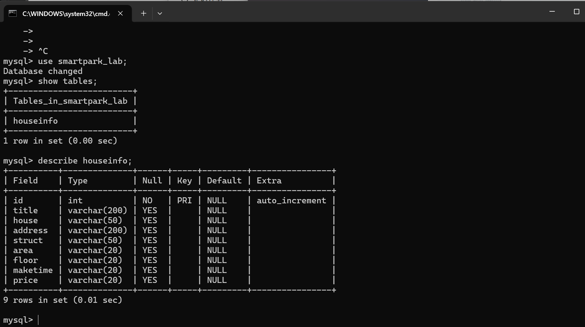

说明：当前使用哪个数据库？`id` 和8个房源字段分别保存什么？

答：当前使用的是 `smartpark_lab` 数据库中的 `houseinfo` 表。`id` 是自增主键，由 MySQL 自动生成并唯一标识一条房源；其余 8 个字段依次保存房源标题、楼盘名、详细地址、户型、面积、楼层、建造年代和单价，字段都定义为 `varchar`，按页面原文入库（如 `89.9㎡`、`16465元/㎡`），便于和网页、CSV 逐字比对。

## 第二阶段：房源采集与 CSV 数据存储

### 1. 网页分析与房源解析

#### 选择器是怎样得到的

在 Chrome 中按 F12，使用 **Elements → Copy → Copy selector**。选一个字段，记录从完整路径到相对选择器的过程。

- 选择的字段：title（标题）
- 复制的原始选择器：`#__layout > div > section > section.list-main > section.list-left > section:nth-child(4) > div:nth-child(1) > a > div.property-content > div.property-content-detail > div.property-content-title > h3`
- 一条房源的父容器选择器：`#__layout > div > section > section.list-main > section.list-left > section:nth-child(4) > div`（60 个），class 为 `property`，即 `div.property`
- 最终使用的相对选择器：容器内 `h3`；其余字段同理（`.property-content-info-comm-name`、`.property-content-info-comm-address`、`.property-content-info-attribute`、`.property-price-average` 等）

**截图：** 框出该字段的 HTML 节点和房源父容器，展示选择器的匹配结果。

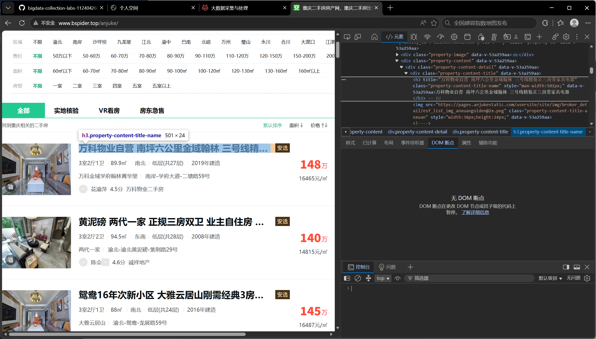

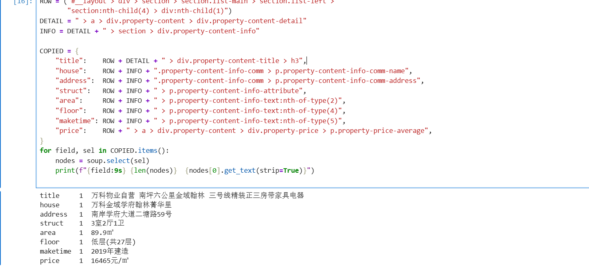

说明：删掉了哪些层级？怎样确认父容器刚好包含一条房源？

答：Copy selector 复制的路径从 `#__layout` 根节点一路写到 `h3`，其中 `#__layout` 到 `section:nth-child(4)` 是整页所有房源共用的外层结构，`div:nth-child(1)` 只是把范围锁死在第 1 条房源，这两部分对循环没有用，所以删掉；保留的 `div:nth-child(1)` 的 class 是 `property`，用它作为一条房源的父容器，容器内部再用相对选择器 `h3` 取标题。确认父容器刚好装一条房源的办法是：`soup.select("div.property")` 匹配到 60 个，正好等于页面每页 60 条，且每个容器内部 `h3` 只匹配 1 个，说明容器既没跨条也没有漏条。

#### 解析8个字段

**截图：** 自己编写的解析代码和首条房源的8个字段输出。代码中必须框出：

- `select()` 和 `select_one()`。
- 面积、单价的定位与取值。
- 建造年代的提取和缺失处理。

可分成几张局部截图。另附面积、单价对应的 HTML 节点或网页原文。

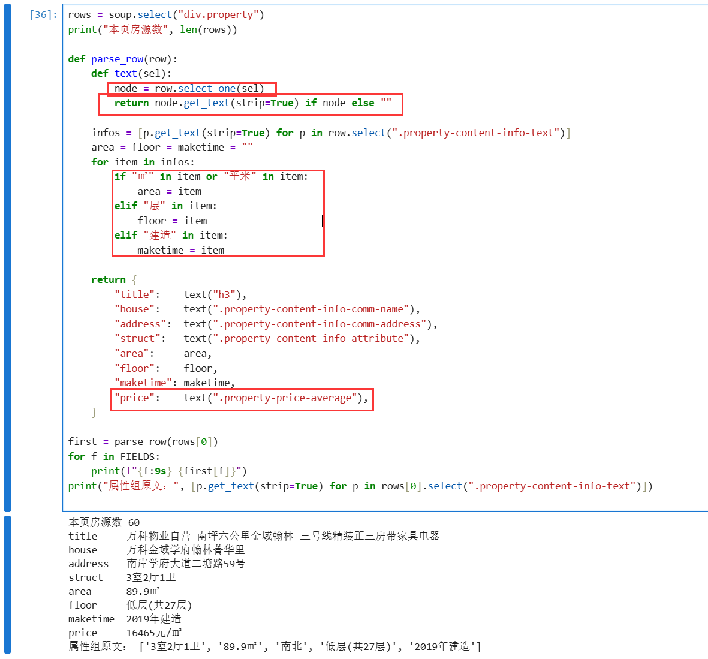

说明：两个选择方法各用在哪里？怎样确认面积和单价没有取错？

答：`select()` 返回列表，用在两处：整页取房源容器 `div.property`（60 条）和取属性组里的 5 个 `p.property-content-info-text`；`select_one()` 返回单个节点，用在每条房源内部取唯一的标题、楼盘、地址、户型和单价。面积和单价没有取错的依据是：单价取 `.property-price-average`（`16465元/㎡`）而不是同级的 `.property-price-total`（148万），面积与网页卡片上的 `89.9㎡` 逐字一致，并把首条 8 字段输出与网页原文并排核对过。

### 2. 下一页采集

- 下一页 `href` 原值：`?page=2`（末页时 `a.next` 的 class 变为只有 `next`、没有 `next-active`，href 为 `#`）
- 用 `urljoin()` 补全后的地址：`http://www.bspider.top/anjuke/?page=2`
- 实际停止原因（明确禁用的末页按钮 / 异常中止）：明确禁用的末页按钮（第 10 页 `a.next` 无 `next-active`，正常结束）

**截图：** 框出提取 `href`、补全地址、循环更新地址和停止条件的代码。附前两页的运行日志，以及最终停止提示。离线实验展示快照中的href、补全结果和文件读取记录，注明"离线回放"，不算在线翻页成功。

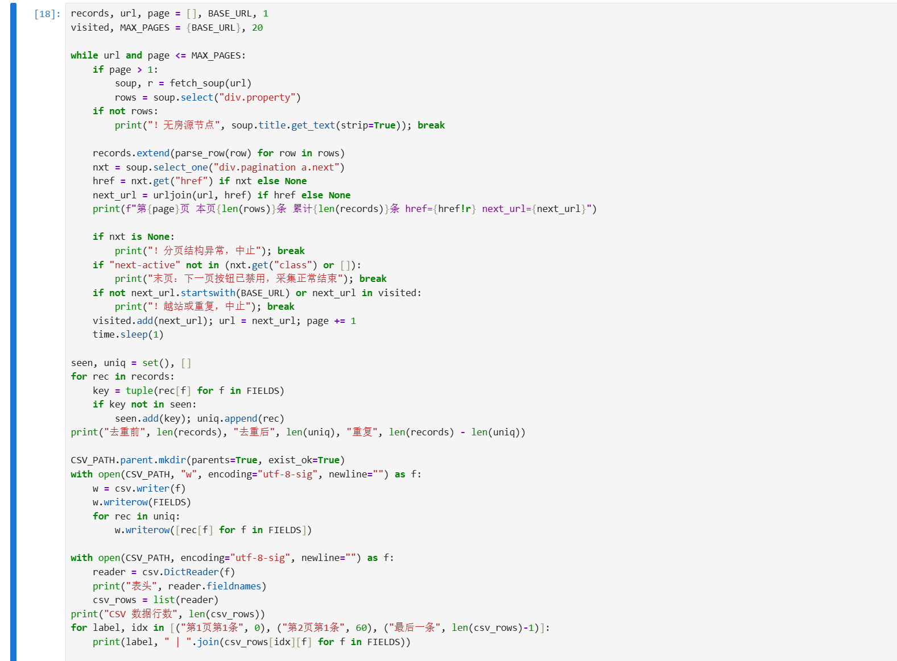

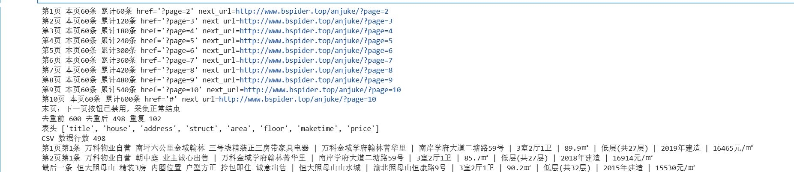

说明：怎样进入下一页？怎样防止重复采集或无限循环？若中途失败，说明停在哪一步。

答：每页先从 `div.pagination a.next` 取出 `href` 原值（如 `?page=2`），用 `urljoin(url, href)` 补成 `http://www.bspider.top/anjuke/?page=2` 作为下一轮请求地址，循环变量 `url` 更新后进入下一页；停止条件是判断 `a.next` 的 class 里是否还有 `next-active`，第 10 页按钮被禁用（href 为 `#`）时 break，日志打印“末页：下一页按钮已禁用，采集正常结束”。防止重复或无限循环用了三重措施：`visited` 集合记录已请求过的地址、`MAX_PAGES` 限制最多 20 页、补全后的地址必须以 `BASE_URL` 开头（防跳站）；本次运行没有中途失败，10 页全部正常结束。

### 3. 保存 CSV

**截图：** CSV保存与回读代码、回读条数。框出编码、表头和数据写入部分。

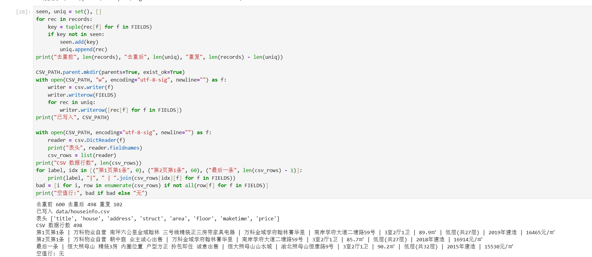

说明：8个字段的顺序是什么？按8个字段完全相同去重后，保存了多少条记录？

答：8 个字段的顺序是 `title, house, address, struct, area, floor, maketime, price`，与表头、INSERT 语句完全一致。按 8 个字段完全相同去重后：采集 600 条、去掉 102 条跨页重复，最终保存 **498 条**，用 `csv.DictReader` 回读确认数据行数为 498、无空值。

## 第三阶段：MySQL 数据存储

### 1. 读取 CSV 并入库

本阶段读取第二阶段的 `data/houseinfo.csv`，不重新采集。

**截图：** 框出读取CSV、按8个字段整理入库参数的代码。

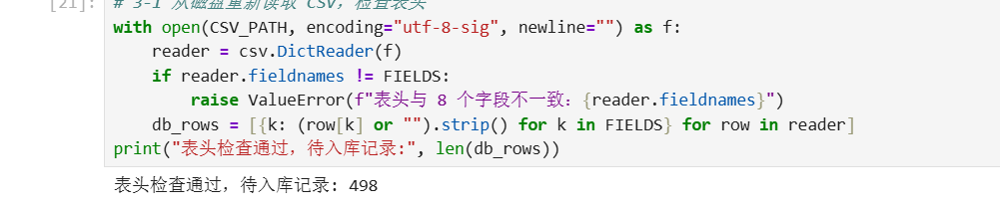

**截图：** 自己编写的入库代码。框出 `executemany()`、`commit()`、`rollback()`，以及关闭游标和连接的操作。另框出避免重复插入的代码。

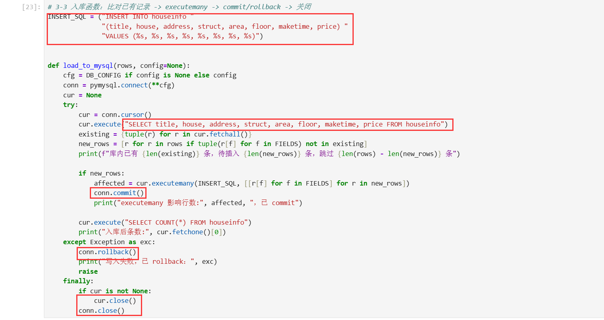

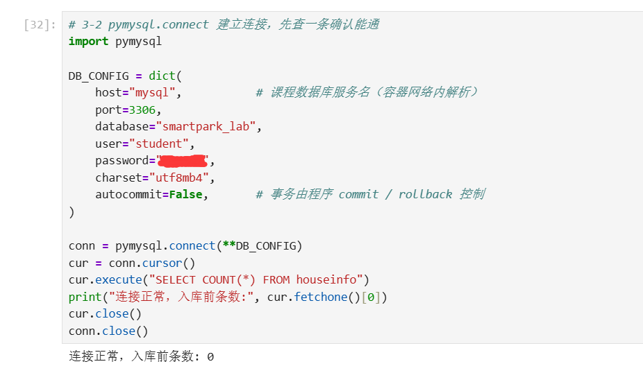

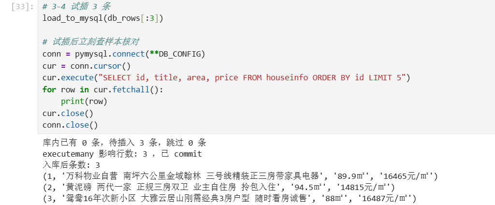

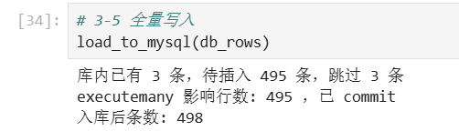

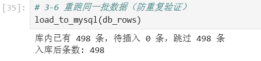

说明：每条记录怎样对应8个参数？成功、失败时分别做什么？再次运行时怎样避免重复插入？

答：每条记录按 `FIELDS` 的固定顺序拼成 `[title, house, address, struct, area, floor, maketime, price]` 列表，与 INSERT 语句里的 8 个 `%s` 一一对应，交给 `executemany()` 批量传参，没有用字符串拼接，避免引号转义和注入问题。成功时 `commit()` 提交并再查一次总数，异常时 `rollback()` 撤销并把异常抛出，`finally` 里先关游标 `cur.close()` 再关连接 `conn.close()`。再次运行时先 `SELECT` 出库内已有的 8 字段组合，用元组比对过滤掉已存在的记录，所以重跑同一批数据会显示“待插入 0 条、跳过 498 条”，条数保持 498 不变。

### 2. 核对结果

#### 查询条数和样本

**截图：** MySQL 终端中的入库前后 `SELECT COUNT(*)`、重跑后的条数，以及 `SELECT ... LIMIT 5` 的结果。

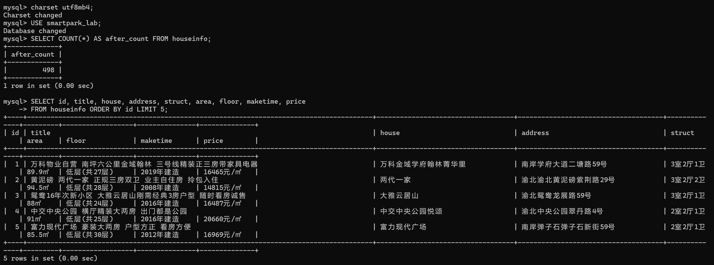

| 项目 | 实际结果 |
|---|---|
| 成功采集页数 | 10 页（每页 60 条） |
| 采集记录数（去重前） | 600 |
| 完全相同的重复记录数 | 102 |
| CSV数据行数（不含表头） | 498 |
| 入库前条数 | 0 |
| 入库后条数 / 本次新增条数 | 498 / 498 |
| 关闭上次程序后，同批数据独立重跑的条数 / 新增条数 | 498 / 0 |
| 是否采集完整；未完成的原因 | 完整：10 页全部采集，末页"下一页"按钮已禁用后正常结束 |

说明：首次入库后的条数应等于去重后的CSV数据行数，8个字段的内容也应一致。若不一致，说明原因。总条数以实际结果为准。

答：首次入库后 `after_count = 498`，正好等于去重后 CSV 的数据行数 498；再重跑一次同一批数据，条数仍为 498、新增 0 条，说明既没有漏写也没有重复插入。8 个字段的内容也用三条样本与网页、CSV 逐字比对过，三处一致，因此条数差异无需说明。

#### 逐条核对

选取第一条、跨页一条和最后一条，比较网页、CSV与数据库中的8个字段。快照实验对照教师提供的网页文件。

**截图：** 三条样本的对照结果，框出面积、单价和年代。可分图。

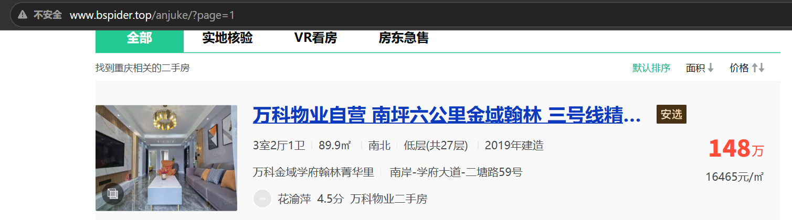

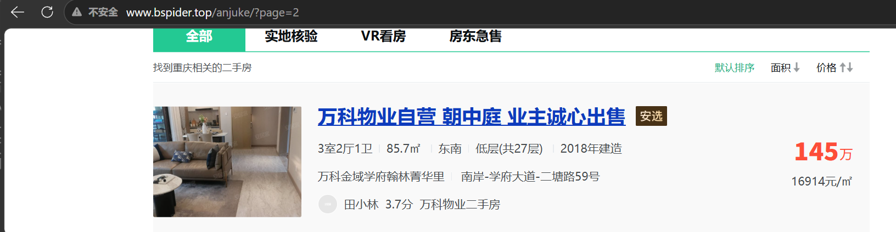

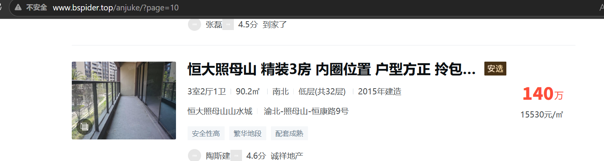

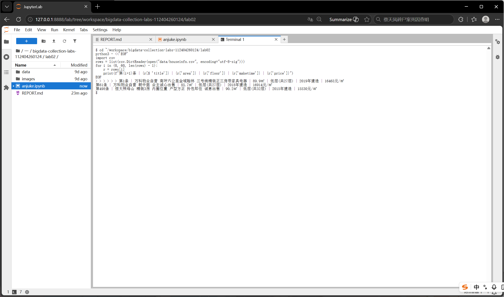

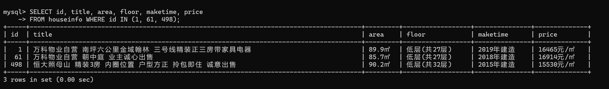

- 样本1（页码或URL、记录位置）：第1页第1条：万科物业自营 南坪六公里金域翰林 三号线精装正三房带家具电器 ｜ 万科金域学府翰林菁华里 ｜ 南岸学府大道二塘路59号 ｜ 3室2厅1卫 ｜ 89.9㎡ ｜ 低层(共27层) ｜ 2019年建造 ｜ 16465元/㎡
- 样本2（页码或URL、记录位置）：第2页第1条（?page=2）：万科物业自营 朝中庭 业主诚心出售 ｜ 万科金域学府翰林菁华里 ｜ 南岸学府大道二塘路59号 ｜ 3室2厅1卫 ｜ 85.7㎡ ｜ 低层(共27层) ｜ 2018年建造 ｜ 16914元/㎡
- 样本3（页码或URL、记录位置）：第10页最后一条：恒大照母山 精装3房 内圈位置 户型方正 拎包即住 诚意出售 ｜ 恒大照母山山水城 ｜ 渝北照母山恒康路9号 ｜ 3室2厅1卫 ｜ 90.2㎡ ｜ 低层(共32层) ｜ 2015年建造 ｜ 15530元/㎡

核对结论及差异：网页、CSV、数据库三处 8 个字段逐字一致，无差异。数据库只多出自增 `id`（1 / 61 / 498 分别对应第 1 条、第 61 条、第 498 条）；面积保留 `㎡`、单价保留 `元/㎡`、建造年代保留“年建造”后缀，与页面原文相同。

## 问题与解决

- 遇到的问题、处理方法及结果（没有可写"无"）：
  1. 只带 User-Agent 请求时返回"访问验证-安居客"页 → 补上 `Referer: http://www.bspider.top/` 后正常返回列表页。
  2. 循环里用 `.txt` 取标题输出 None → BeautifulSoup 未知属性返回 None，改用 `.get_text(strip=True)`。
  3. Notebook 内核工作目录失效导致 `mkdir('data')` 报 FileNotFoundError → 用 `os.chdir()` 切回 lab02 目录。
  4. 写 CSV 报 PermissionError → 文件属主不是当前用户，修正属主后正常。
- 尚未解决的问题、未完成的步骤（没有可写"无"）：无。

## 思考题

1. 本次怎样实现下一页采集？结合自己的代码说明。

   答：用 `while url and page <= MAX_PAGES` 驱动循环：每页先 `records.extend(parse_row(row) for row in rows)` 收集 60 条，再从 `div.pagination a.next` 取 `href`，`next_url = urljoin(url, href)` 补全成绝对地址后赋给 `url`，`page += 1` 进入下一页，每轮 `time.sleep(1)` 控制请求频率。循环出口是 `a.next` 的 class 里不再有 `next-active`（末页按钮被禁用、href 为 `#`），此时打印“末页：下一页按钮已禁用，采集正常结束”并 break，所以第 10 页只采一次就停，不会去请求不存在的第 11 页。

2. 旧代码把 out_list 定义在全局。你把结果列表放在哪里？为什么？

   答：结果列表放在采集单元内部，用 `records, url, page = [], BASE_URL, 1` 在单元开头重新初始化为空列表，随循环 `extend` 累积；解析函数 `parse_row()` 只返回单条字典，不往任何外部列表里写，函数本身没有副作用。之所以不定义成全局变量、在函数里追加，是因为那样重复运行单元时数据会不断叠加（600 变 1200），去重和条数都会失真；现在每次运行都从空列表开始，跑几次结果都一样，也不会被上一次的残留数据干扰。

3. 你怎样获取建造年代？节点缺失或顺序改变时，怎样处理？

   答：建造年代不按固定序号取，而是把属性组的 5 个 `p.property-content-info-text` 全部取出后遍历，判断哪一项含“建造”就赋给 `maketime`（如 `2019年建造`），面积和楼层同样用 `㎡`、`层` 作为特征定位。若某条房源缺少年代，循环里没有命中就保持空字符串，不报错也不影响其他字段；因为不依赖 `nth-of-type` 的固定位置，即使页面少了一项或属性顺序变化，面积、楼层、年代也不会相互错位。

## 提交检查

- [ ] 实验一原仓库的 `lab02/` 中已有源码、CSV、报告和真实截图。
- [ ] 截图清楚，关键代码已框出，每项附有个人解释。
- [ ] GitHub上能打开文件和图片，未上传个人账号密码、`.env`或教师答案。
- [ ] 未完成项已如实说明；学习通只交原仓库链接。

如使用 AI，简述它帮助了什么，以及自己修改、运行和核对了什么：
使用了 AI 辅助：由它给出 requests + BeautifulSoup 的采集骨架、分页停止条件的写法、pymysql 入库函数的模板，以及排查“访问验证页”“.txt 取值为 None”“内核工作目录失效”“文件属主导致 PermissionError”几个报错。自己完成的部分：在 JupyterLab 中逐单元运行并观察每步输出，用 Chrome 的 Copy selector 核对并调整各字段选择器，按网页原文核对面积/单价/年代的取值是否正确，执行 CSV 去重与入库（0 → 3 → 498 → 重跑 0），并在 MySQL 终端逐条比对三条样本与 CSV、网页是否一致。
